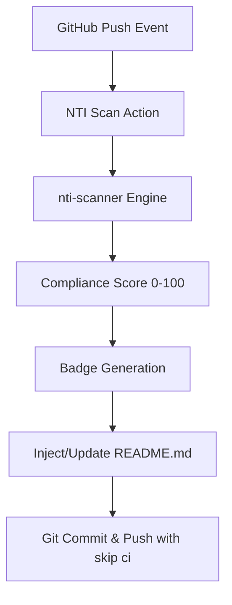

[](https://nti-registry.vercel.app)

# nti-scan-action

Zero-Config NTI Compliance Scanner & Automated Badge Generator for GitHub Actions.

`nti-scan-action` automatically scans your AI agent repositories for security vulnerabilities, evaluates compliance against the NTI framework, and dynamically updates your `README.md` with an official NTI Verified badge.

---

## Quick Start

Add the following workflow to `.github/workflows/nti-scan.yml` in your repository:

```yaml
name: NTI Compliance Scan

on:
  push:
    branches: [ main ]

permissions:
  contents: write

jobs:
  scan:
    runs-on: ubuntu-latest
    steps:
      - name: Checkout Repository
        uses: actions/checkout@v4

      - name: Run NTI Scan Action
        uses: abisheakp197/nti-scan-action@main
        with:
          github-token: ${{ secrets.GITHUB_TOKEN }}
```

---

## Inputs

| Input | Description | Required | Default |
| --- | --- | --- | --- |
| `github-token` | GitHub token used to commit and push the updated NTI badge back to your repository. | **Yes** | N/A |
| `fail-on-vulnerability` | When set to `true`, fails the action build if the compliance score is `< 80`. | No | `'false'` |

---

## Privacy First

This action runs **entirely inside your GitHub Runner**.

- **Your source code is never sent to external servers or NTI services.**
- Only the computed numerical compliance score is rendered onto the badge.
- Complete operational privacy is preserved for enterprise and private repositories.

---

## Architecture



---

## License

This project is licensed under the [Apache 2.0 License](LICENSE).
